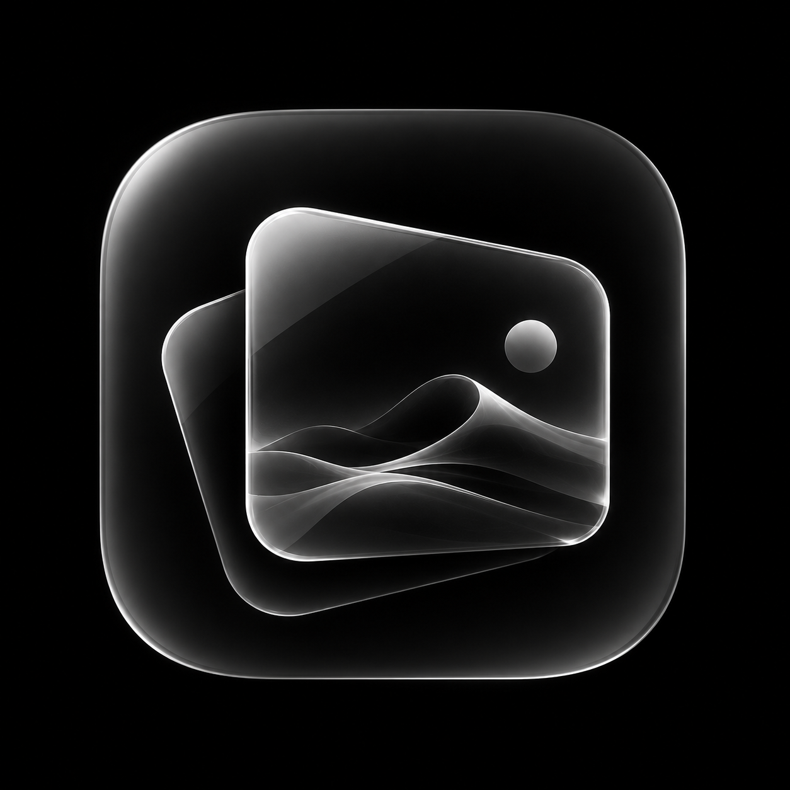

<div align="center">



# NŌR

### Modern, Hardware-Accelerated Dynamic Live Wallpaper Engine for macOS

[](https://apple.com)
[](https://swift.org)
[](https://apple.com)
[](LICENSE)
[](#-intelligent-power--audio-management)

<p align="center">
  <a href="#-key-features">Key Features</a> •
  <a href="#-architecture--how-it-works">Architecture</a> •
  <a href="#-supported-formats">Supported Formats</a> •
  <a href="#-getting-started">Getting Started</a> •
  <a href="#-building-from-source">Building</a> •
  <a href="#-contributing">Contributing</a> •
  <a href="#-license">License</a>
</p>

</div>

---

## 🌟 Overview

**NŌR** is a lightweight, high-performance live wallpaper engine built natively for macOS using **SwiftUI**, **AppKit**, and **AVFoundation**.

Unlike Electron or web-wrapper based wallpaper tools that consume excessive RAM and drain your battery, **NŌR** renders directly at the desktop window server level using zero-copy hardware acceleration. It is designed to be invisible when you work, and breathtaking when you admire your desktop.

---

## ✨ Key Features

### 🖥️ Native Desktop Canvas Integration
- Renders directly behind your desktop icons (`kCGDesktopWindowLevel`) without blocking desktop clicks, selection rectangles, or file dragging.
- Preserves native macOS gestures, Mission Control, Exposé, and Stage Manager workflows.

### ⚡ Intelligent Power & Audio Management (`FullScreenAppMonitor`)
- **Zero-Drain Full-Screen Suspension**: Actively monitors workspace changes and instantly freezes video decoding when full-screen apps, games, or presentations are active—reducing idle GPU and CPU usage to **0%**.
- **Context-Aware Audio Ducking**: Plays ambient wallpaper sound only when you are on the desktop. When any app window appears on the screen, wallpaper audio is automatically muted to prevent distraction during work, calls, or media playback.

### ✂️ Built-In Video Trimmer & Crop Studio
- **Precision Trimming**: Non-destructively trim intro/outro segments or select seamless loop points with real-time frame scrubbing.
- **Aspect Ratio Cropping**: Quickly crop ultra-wide, vertical, or non-standard videos to perfectly match your Mac screen (16:9, 16:10 MacBook Retina, 21:9 Ultrawide, or custom).

### 🎞️ Universal Media Support & Instant Transcoding
- **Zero-Dependency Animated Image Converter**: Built-in native converter transforms GIFs, animated WebP, and APNG files into hardware-accelerated MP4 loops using Apple's `ImageIO` and `AVAssetWriter`.
- **FFmpeg Stream Remuxing**: Seamlessly remuxes and decodes MKV, WebM, AVI, and FLV containers with hardware-accelerated VideoToolbox support.

### 🧭 Menu Bar Companion
- Discreet status bar icon allowing you to toggle playback, mute/unmute audio, switch wallpapers, launch at login, and access preferences with a single click.

### 🔒 Privacy & Sandboxing
- Built with Apple **Security-Scoped Bookmarks**, allowing your custom wallpaper library to persist reliably across system restarts without requesting broad file system permissions.

---

## 🏗️ Architecture & How It Works

```mermaid
flowchart TD
    App[NŌR Application] --> MenuBar[MenuBarManager]
    App --> UI[ContentView (SwiftUI Studio)]
    
    UI --> Gallery[WallpaperGalleryManager]
    UI --> Playback[WallpaperPlaybackManager]
    
    Playback --> DesktopWin[WallpaperWindowController]
    DesktopWin --> Layer[AVPlayerLayer (Direct Zero-Copy Layer)]
    
    Monitor[FullScreenAppMonitor] -->|Space / Occlusion Change| Playback
    Monitor -.->|Full-Screen Active| Pause[Suspend Video Decoding (0% GPU)]
    Monitor -.->|App Window Open| Mute[Auto-Mute Sound]
    Monitor -.->|Clean Desktop| Resume[Smooth Video & Audio Resume]
    
    Import[Import Media] --> FormatCheck{Format?}
    FormatCheck -->|MP4 / MOV / M4V| Direct[Native AVPlayer Playback]
    FormatCheck -->|GIF / WebP / APNG| ImgIO[AnimatedImageConverter (ImageIO)]
    FormatCheck -->|MKV / WebM| Transcode[VideoFormatConverter (VideoToolbox / FFmpeg)]
    ImgIO --> Gallery
    Transcode --> Gallery
```

---

## 📊 Supported Formats

| Format / Extension | Playback Engine | Notes |
|---|---|---|
| `.mp4`, `.mov`, `.m4v` | Native `AVFoundation` | Direct zero-copy hardware acceleration (H.264, HEVC, ProRes) |
| `.gif`, `.webp`, `.apng` | `AnimatedImageConverter` | Automatically converted to high-performance MP4 loop via native ImageIO |
| `.mkv`, `.webm` | `VideoFormatConverter` | High-speed remuxing via Apple Silicon VideoToolbox (FFmpeg accelerated) |
| `.avi`, `.flv`, `.wmv` | `VideoFormatConverter` | Transcoded to hardware-compatible MP4 format |

> [!TIP]
> To enable ultra-fast MKV and WebM importing, ensure FFmpeg is installed on your system via Homebrew:
> ```bash
> brew install ffmpeg
> ```

---

## 🚀 Getting Started

### System Requirements
- **Operating System**: macOS 14.0 (Sonoma) or macOS 15.0 (Sequoia) and newer
- **Architecture**: Apple Silicon (M1/M2/M3/M4) or Intel Mac

### Option 1: Download Pre-built Release
1. Navigate to the [Releases](https://github.com/Yuki-Mac/Wallpaper-Engine-NOR/releases) page.
2. Download the latest `NŌR-macOS.zip`.
3. Unzip and drag `NŌR.app` to your `/Applications` folder.
4. Launch **NŌR** and add your favorite video or animated wallpaper!

---

## 🛠️ Building from Source

### 1. Clone the Repository
```bash
git clone https://github.com/Yuki-Mac/Wallpaper-Engine-NOR.git
cd Wallpaper-Engine-NOR
```

### 2. Open in Xcode
```bash
open "Wallpaper engine.xcodeproj"
```
Select the **Wallpaper engine** scheme and press **⌘R** to build and run.

### 3. Build via Command Line
```bash
xcodebuild -scheme "Wallpaper engine" -configuration Release build
```

### 4. Create a Packaged Release (`.zip` + SHA256)
We provide an automated build script:
```bash
./scripts/build_release.sh
```
The resulting release bundle will be available in the `./release` folder.

---

## 🗂️ Project Directory Structure

```text
Wallpaper-Engine-NOR/
├── .github/
│   ├── ISSUE_TEMPLATE/
│   │   ├── bug_report.yml          # Structured bug report form
│   │   ├── feature_request.yml     # Feature proposal form
│   │   └── config.yml              # Issue template configuration
│   ├── workflows/
│   │   └── build.yml               # GitHub Actions CI build & verification
│   └── pull_request_template.md    # Pull Request submission checklist
├── assets/
│   └── logo.png                    # High-resolution application icon
├── scripts/
│   └── build_release.sh            # Automated release packaging script
├── Wallpaper engine/
│   ├── Wallpaper_engineApp.swift   # App entry point & lifecycle
│   ├── ContentView.swift           # Main SwiftUI Studio UI & controls
│   ├── WallpaperWindowController.swift # Desktop window & AVPlayerLayer
│   ├── WallpaperPlaybackManager.swift  # AVFoundation player & loop logic
│   ├── WallpaperGalleryManager.swift   # Library persistence & bookmarks
│   ├── FullScreenAppMonitor.swift  # Occlusion & auto-pause/mute monitor
│   ├── AnimatedImageConverter.swift# GIF/WebP/APNG to MP4 converter
│   ├── VideoFormatConverter.swift  # MKV/WebM stream remuxer
│   ├── VideoCropSheet.swift        # Aspect ratio cropping tool
│   ├── VideoTrimSheet.swift        # Video trimming tool
│   ├── MenuBarManager.swift        # macOS Menu Bar companion
│   ├── SecurityScopedResourceManager.swift # Permission management
│   └── Assets.xcassets/            # App icons, colors, and image sets
├── .gitignore                      # Xcode, macOS, and build artifact rules
├── CHANGELOG.md                    # Release history & version notes
├── CONTRIBUTING.md                 # Contribution guidelines
├── LICENSE                         # MIT License
├── README.md                       # Documentation
└── SECURITY.md                     # Security vulnerability policy
```

---

## 🤝 Contributing

Contributions are warmly welcomed! Please read our [CONTRIBUTING.md](CONTRIBUTING.md) guide for details on our code of conduct, development workflow, and pull request process.

1. Fork the Project
2. Create your Feature Branch (`git checkout -b feature/AmazingFeature`)
3. Commit your Changes (`git commit -m 'feat: add amazing feature'`)
4. Push to the Branch (`git push origin feature/AmazingFeature`)
5. Open a Pull Request

---

## 📄 License

Distributed under the **MIT License**. See [LICENSE](LICENSE) for more information.

---

<div align="center">
  <sub>Crafted with precision for macOS. Made by <a href="https://github.com/Yuki-Mac">Yuki</a>.</sub>
</div>
